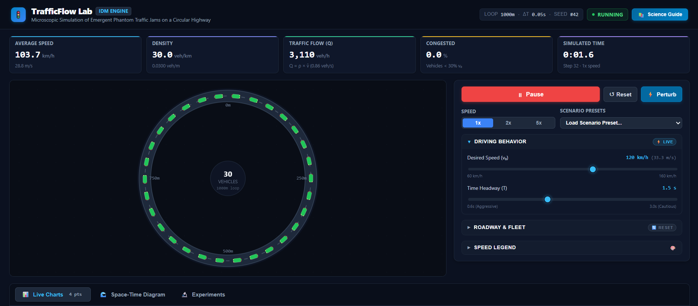
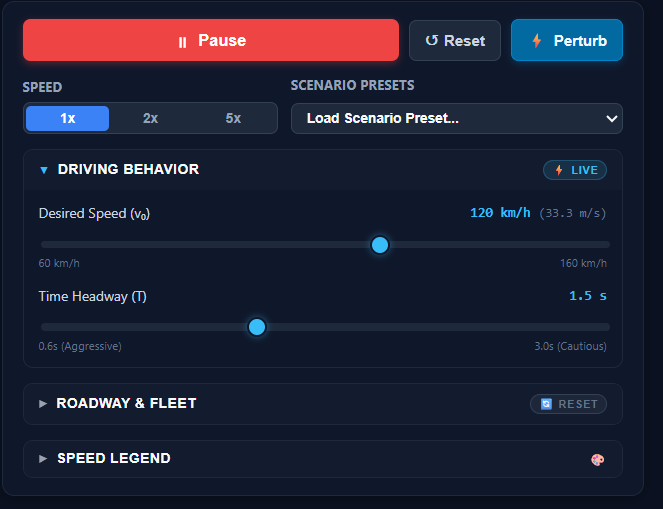

# TrafficFlow Lab 🚦

**An interactive traffic simulator and computational experimentation platform for exploring how traffic jams emerge without accidents or bottlenecks.**

[**🚀 Try the Live Demo**](https://trafficflow-2mxisdqn4-ryan-lin.vercel.app/) · [**View Source**](https://github.com/linry07/trafficflow-lab) · [**Run Locally**](#getting-started)



*Real-time circular highway simulation with speed-colored vehicles, live traffic metrics, and driver controls.*

## What can you do with it?

- **Create phantom traffic jams:** Adjust vehicle density, desired speed, and following time; introduce a braking disturbance and watch how drivers respond.
- **Inspect traffic behavior:** Monitor average speed, density, flow, and congestion in real time.
- **Visualize waves:** Explore time-series charts and a space-time diagram showing how stop-and-go patterns travel backward through traffic.
- **Run repeatable experiments:** Sweep vehicle counts across a fixed road length, run seeded trials in a Web Worker, and estimate where sustained congestion becomes common under the chosen model parameters.
- **Replay and export:** Load a completed trial in the interactive simulator or export results as CSV/JSON for further analysis.

### Try it in under a minute

1. Open the **[live app](https://trafficflow-2mxisdqn4-ryan-lin.vercel.app/)**.
2. Select the **Unstable Baseline** preset and click **Perturb**.
3. Switch to **Space-Time Diagram** to see how the disturbance propagates.
4. Open **Experiments** and launch a density sweep. Select a trial to replay it.

## Screenshot: Simulation controls



<!-- Future: add actual screenshots of the Space-Time Diagram and Experiments results after capturing them from the deployed application. -->

## How it works

TrafficFlow Lab simulates individual vehicles following one another on a **single-lane, 1,000 m circular road**. The ring has no entrances, exits, or intersections, which makes it useful for isolating traffic-wave behavior.

Each car uses the **Intelligent Driver Model (IDM)**, a car-following model that computes longitudinal acceleration from its speed, desired speed, distance to the leader, and relative speed:

$$
\frac{dv}{dt}=a\left[1-\left(\frac{v}{v_0}\right)^\delta-\left(\frac{s^*(v,\Delta v)}{s}\right)^2\right]
$$

$$
s^*(v,\Delta v)=s_0+vT+\frac{v\Delta v}{2\sqrt{ab}}
$$

Here, $v_0$ is desired speed, $T$ is desired time headway, $s_0$ is minimum gap, and $a$ and $b$ are the acceleration and comfortable braking parameters. Vehicles observe their **immediate leader**, not a communication network. The baseline fleet uses the same IDM parameter set for every car.

The physics engine uses a **fixed 0.05 s timestep** and periodic boundary conditions, independent of the browser's rendering frame rate. Under suitable conditions, a braking disturbance can grow into a sustained backward-moving traffic wave.

## Automatic Experiment Discovery

The experiment engine executes the **same simulation model without rendering**, in a Web Worker. It can:

- Sweep across vehicle counts/densities and run multiple reproducible seeded trials.
- Classify free flow, temporary disturbances, uniform slow traffic, and sustained stop-and-go congestion.
- Estimate the observed fraction of runs classified as sustained jams, with **Wilson score intervals** over the selected seed ensemble.
- Replay individual trials using their recorded parameters, seed, and disturbance schedule.
- Export raw trial data, aggregate summaries, and live time series.

**Interpretation matters:** the simulator is deterministic for a fixed configuration and seed. Estimated jam occurrence rates describe the tested distribution of initialization conditions and model parameters; they are **not universal real-world traffic probabilities**. Matching seeds across density levels supports controlled comparisons. The software does not currently implement V2V communication, lane changes, or a dynamic variable-speed-limit controller.

## Engineering highlights

| Area | Implementation |
| --- | --- |
| Physics | Pure TypeScript IDM engine, circular-road boundaries, fixed-timestep numerical integration |
| Interface | React, TypeScript, Vite, responsive HTML Canvas visualization |
| Analytics | Recharts time series, space-time visualization, traffic metrics |
| Experimentation | Headless parameter sweeps in a Web Worker, reproducible seeds, cancellation and restart |
| Statistics | Congestion classification, Wilson score intervals, aggregate trial metrics |
| Reliability | Physics invariants, deterministic replay tests, numerical checks, UI and worker tests |
| Deployment | Static Vite application hosted on Vercel; no backend or account required |

### Architecture

```text
src/
├── engine/         IDM physics, vehicles, road state, metrics, seeded PRNG
├── analytics/      Time-series, space-time grids, congestion detection, export
├── experiments/    Headless trials, statistics, Web Worker lifecycle
├── visualization/  Highway and vehicle Canvas rendering
├── components/     Dashboard, controls, charts, experiments, science guide
└── hooks/          Simulation lifecycle and frame-independent stepping
```

Keeping the simulation engine independent of React and the DOM allows it to be tested and used for fast headless experimentation. Heavy experiment sweeps run off the main UI thread; users can cancel and restart them without interrupting the live simulator.

## Getting started

**Requirements:** Node.js 18+ and npm.

```bash
git clone https://github.com/linry07/trafficflow-lab.git
cd trafficflow-lab
npm ci
npm run dev
```

Open the local address printed by Vite (usually `http://localhost:5173`).

```bash
npm test        # Run automated tests
npm run lint    # ESLint
npm run build   # TypeScript checks and production bundle
```

The latest local UI redesign report recorded **191 passing automated tests**. As with any simulation, tests validate specified behaviors and invariants, not every possible physical scenario.

## Model scope and limitations

TrafficFlow Lab is an educational and computational demonstration, not an operational traffic-management system. It currently models a single-lane ring with homogeneous, single-leader car-following. Reduced-speed and short-headway presets change IDM parameters; they do not implement full real-world policy systems or connected autonomous vehicle communication.

## License

Distributed under the [MIT License](LICENSE).
